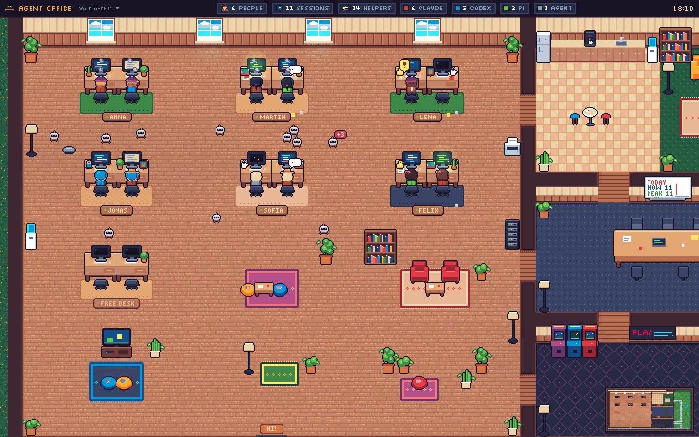
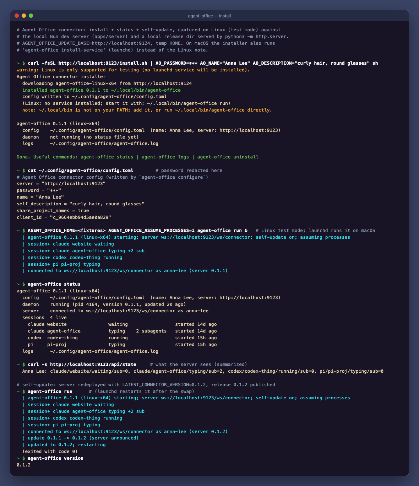
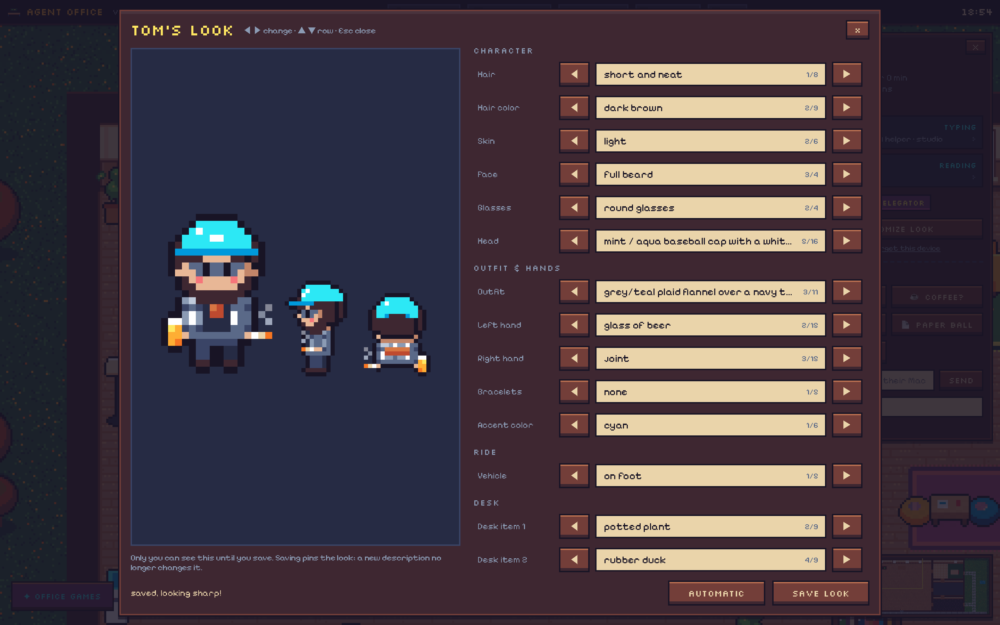
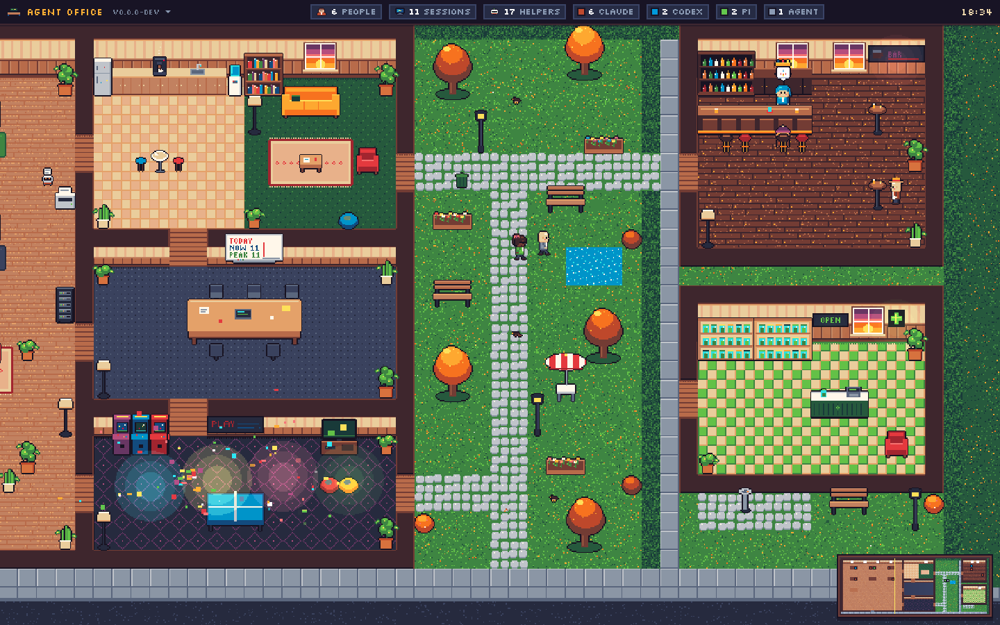
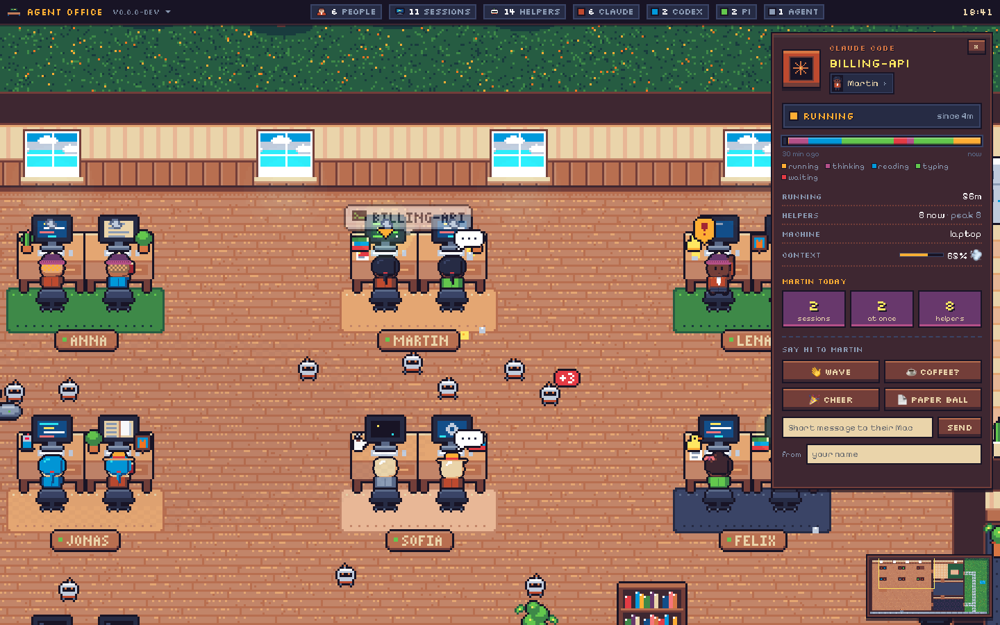
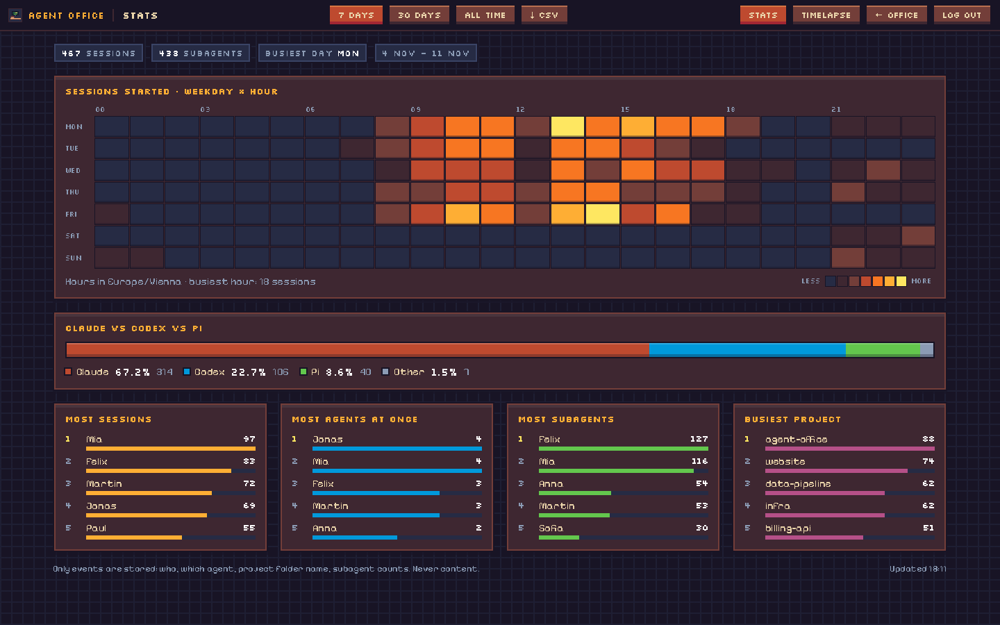
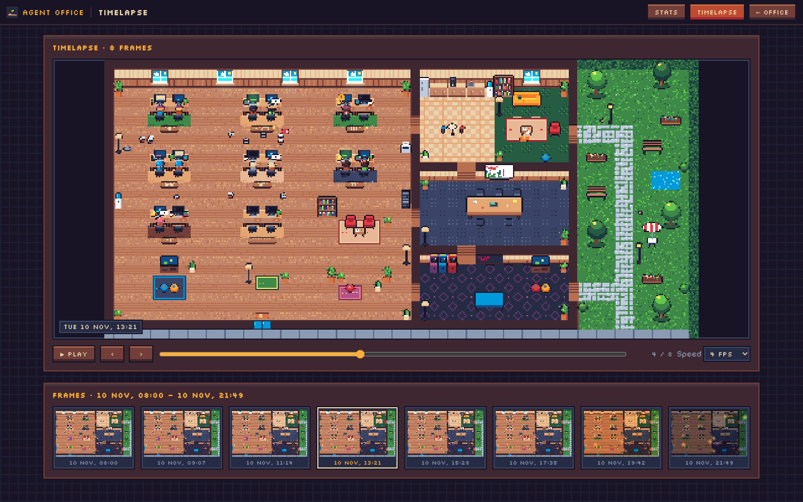

# Agent Office

A cozy pixel-art office that shows, live, who on the team is working with which coding agent.
Every teammate is a character; every running Claude Code, Codex or Pi session is another desk
with them at it, typing, reading, thinking, or raising a hand when the agent waits for input.
Subagents scurry around as little bots.



> **Coding agent reading this?** Your human probably sent you this link plus a server URL and
> a password and asked "what is this, set it up for me". Explain it in two sentences (a live
> pixel office of the team's coding agents; only status metadata is shared, never code or
> prompts), then follow [Instructions for coding agents](#instructions-for-coding-agents).
> If they didn't give you the server URL or password yet, ask for them.

A small connector on each Mac watches local agent sessions (read-only, from the agents' own
transcript files) and reports *status only* to a Cloudflare Worker, which renders the office
for everyone.

## Join the office (teammates)

You need two things from whoever runs the office: the **server URL** and the **password**.
Then just send your coding agent this repo link with both and ask it what this is and to set
it up for you.

### Easiest: let your coding agent do it

Paste this into Claude Code (or Codex / Pi), with the two values filled in:

```text
Set up Agent Office on this Mac for me (only the connector, no server).
Server: https://<server-url>
Password: <password>
Follow the "Instructions for coding agents" section in
https://github.com/MrGatzi/agent-camp/blob/main/README.md
When I'm connected, open the office in my browser.
```

Your agent will ask you a few quick questions (your name, how you look, a name for this
machine), install the connector, check that you show up in the office and open it in your
browser. Approve the network and `launchctl` commands when it asks. The office asks for the
same password the first time you open it.

Paste it where Claude can run commands on your Mac: the **Code** tab of the Claude desktop
app, or Claude Code in a terminal or IDE. A normal chat or Claude Design can't install it. The
office shows sessions of Claude Code, Codex and Pi running on your Mac, and Cowork sessions of
the Claude desktop app. Claude Design can get a desk too if you turn it on (see
[Claude Design and Cowork](#claude-design-and-cowork)). claude.ai chats run in the cloud and
don't appear.

### By hand

```sh
curl -fsSL https://github.com/MrGatzi/agent-camp/releases/latest/download/install.sh | sh
```

It asks five things: the **server URL**, the **password**, your **name**, an optional
**description** of your look that shapes your avatar (a few words like "curly hair, round
glasses", or a detailed paragraph), and a **name for this machine** (defaults to its short
hostname). Done: the connector runs in the background (launchd), starts at login and updates
itself. Re-run the same line any time to change answers.

A long description is easier in a file: `agent-office configure --description-file ~/look.md`
(or `AO_DESCRIPTION_FILE=~/look.md` for the installer), then
`launchctl kickstart -k gui/$(id -u)/dev.agentoffice.connector` so the office redraws you.
Don't hand-edit a multi-line description into `config.toml` as a TOML `"""…"""` string:
the connector reads only single-line values there, so use `configure --description-file`
(it stores line breaks escaped).

```sh
agent-office status      # connected? which sessions does it see?
agent-office logs        # follow the log
agent-office uninstall   # stop and remove everything
```



### Instructions for coding agents

You are setting up the Agent Office connector for the human you are working with. They gave
you a server URL and a password. Do this:

1. Check the machine: `uname -sm` should say `Darwin arm64` or `Darwin x86_64` (macOS only).
2. Ask the human, in one message, and wait for the answers:
   - **Display name** shown in the office (first name is fine). If they already run Agent
     Office on another machine, it must be the **same name** there so both count as one person.
   - **Look** (optional): a few words ("curly hair, round glasses, hoodie") or a detailed
     paragraph (hair, glasses, each piece of clothing with colours, shoes, pose; up to ~8000
     characters). See [How do I look?](#how-do-i-look).
   - **Machine name** (optional): a label for this computer, default `hostname -s`
     (e.g. "laptop", "devbox").
   - **Share project folder names?** (default yes). Only the folder's base name is ever sent.
3. Install without prompts (the env vars must be on `sh`, not on `curl`):
   ```sh
   curl -fsSL https://github.com/MrGatzi/agent-camp/releases/latest/download/install.sh \
     | AO_NONINTERACTIVE=1 AO_SERVER='<server-url>' AO_PASSWORD='<password>' \
       AO_NAME='<name>' AO_DESCRIPTION='<look or empty>' AO_MACHINE='<machine name>' sh
   ```
   The binary lands in `~/.local/bin/agent-office` and a launchd agent
   (`dev.agentoffice.connector`) starts it now and at every login. This needs network access
   and `launchctl`; if your sandbox blocks them, ask the human to approve or to run the command.
   For a look longer than a line (or with quotes or line breaks), write it to
   `~/.config/agent-office/look.md` and pass
   `AO_DESCRIPTION_FILE="$HOME/.config/agent-office/look.md"` instead of `AO_DESCRIPTION`.
   To change the look later:
   ```sh
   ~/.local/bin/agent-office configure --description-file ~/.config/agent-office/look.md
   launchctl kickstart -k gui/$(id -u)/dev.agentoffice.connector
   ```
4. If they said **no** to project folder names:
   ```sh
   ~/.local/bin/agent-office configure --share-project-names false
   launchctl kickstart -k gui/$(id -u)/dev.agentoffice.connector
   ```
5. Verify: run `~/.local/bin/agent-office status`. It must say **connected** and should list
   this very session (it needs a transcript write in the last 90 s, so check after a moment).
   If it is not connected, look at `~/.local/bin/agent-office logs` (Ctrl-C to stop): a
   rejected password means a typo; a connection error usually means a wrong URL (use the
   `https://` address of the office).
6. If `~/.local/bin` is not on their `PATH`, offer to add it to `~/.zshrc`.
7. Open the office for them: `open '<server-url>'` (it asks for the same password once).
   Tell the human it worked and that they can watch at the server URL in any browser.
   Don't echo the password back in your summary.

The connector only reads agent transcript metadata and never sends prompts, code or file
contents (see Privacy below), so no other setup is needed.

### Two machines, one you

Run the connector on every machine you code on (laptop, remote devbox, ...) and give it the
**same name** everywhere: the office matches people by name (case and extra spaces don't
matter), so you stay one character with one look, and the sessions from all your machines
sit side by side in your pod. The description only needs to be set on one machine; a machine
without one never changes your look, and the last description you set wins. The machine
name (`agent-office configure --machine-name devbox`, or `AO_MACHINE=` for the installer)
shows up on the agent card so you can tell the sessions apart.

### Claude Design and Cowork

For teammates who work in the Claude desktop app instead of a terminal.

**Cowork** needs no setup. While the Claude app runs, each Cowork session is a Claude desk
with the project name "Cowork" and real activity (typing, reading, thinking, waiting). A
quiet session keeps its desk for 30 minutes.

**Claude Design** runs on Anthropic's servers, so the connector can't see what Claude is
doing there. It can only see that a Design window of the Claude app is open. Turn that on
with:

```sh
agent-office configure --design-window true
launchctl kickstart -k gui/$(id -u)/dev.agentoffice.connector
```

Then open a Design window in the Claude app. macOS asks whether `agent-office` may control
"System Events": allow it, and also allow `agent-office` under **System Settings → Privacy &
Security → Accessibility**. `agent-office status` tells you whether the permission is still
missing.

You then get a pink "Claude Design" desk: **thinking** while the Design window is in front,
**idle** after it has been in the background for two minutes, and gone when you close it. It
never shows "waiting", because the connector can't know that. This works when the Claude app
is set to English or German (the window must be titled "Design"), and only in the desktop
app, not in a browser.

### How do I look?

The server picks your look. With AI off it comes from a hash of your name. With AI on it is
drawn from your description: a few words work, but a detailed one (up to ~8000 characters)
gets you a detailed character: hair cut and colour, glasses and their frame, each layer of
clothing with its collar, buttons, pockets, pattern and embroidery, socks, shoes, even an
expression and a pose. Exact colours (`#1f3d2b`, "forest green") are used as given. All of it
is painted by the same renderer at the same pixel size, so everyone stays in one style.

Which agent a session runs (Claude, Codex, Pi, Claude Design) shows in its colour: if you
don't name a jacket colour, your jacket takes the agent's colour as before; if you do, you
keep your jacket and get a badge on the chest (and a patch across the shoulders from behind)
in the agent's colour instead. Every extra
session is a sibling of you with tiny variations, and your pod has one desk per running
session (at least 2, up to 6).

Want a say? Click your name plate. The first time, tap **It's me: send a code**: a 6-digit
code pops up as a notification on your Mac (via the connector, so its notifications must be
allowed in macOS; if nothing shows up, send again after 30 s), and typing it in marks this
browser as you. From then on **Customize look** opens a fullscreen studio: flip through hair,
face, glasses, cap, outfit (jacket, hoodie, flannel, tee), something for each hand (beer,
coffee, phone, ...), your ride and desk items with the ◀ ▶ buttons (or the arrow keys), with a
big live preview. You can only change your own look. This is a courtesy lock for a team
office, not real identity: anyone with the office password could start a connector under your
name. Saving pins it; **Automatic** goes back to the one from your description. On a shared device, "not you? forget this device" (or
logging out) drops the claim. Outfits that are not in the agent colour carry a small agent
badge on the tee and a band across the back, so you can still tell Claude from Codex at the
desk.



### Privacy

Sent: agent kind (Claude/Codex/Pi), a salted hash of the session id, the project **folder
name** (turn off with `share_project_names = false` in `~/.config/agent-office/config.toml`),
an activity verb (typing/reading/thinking/running/waiting/idle), the subagent count, how full
the context window is (a percentage), when the
session started, the connector version, the **machine name** you chose (`machine_name`,
defaults to the short hostname, e.g. `martins-mbp`; set it to anything you like), and your
**look description** (up to 8000 characters, if you set one). The server keeps the
description to draw your avatar (with AI on it goes to the configured AI provider) and never
shows it to viewers; they only see the finished avatar.

With `design_window` on (see [Claude Design and Cowork](#claude-design-and-cowork)), the
connector asks macOS for the Claude app's window titles and sends only whether a Design
window is open and in front. The titles stay on your Mac. For Cowork sessions the project
name is always "Cowork".

Optional: `agent-office configure --birthday MM-DD` and the office brings you a cake that day
(only "it's your birthday today" is ever shown, never the date).

Received: when someone in the office waves at you or sends you a short message, the
connector shows it as a macOS notification (at most one every 5 s; macOS may list it under
"Script Editor"). Turn it off with `agent-office configure --notifications false`.

Never sent: prompts, responses, code, file contents or paths, commands, tool output, or
anything else from a transcript. A unit test feeds a transcript containing a fake secret and
checks it never appears in any outgoing message. History keeps only events (who, which agent,
project folder name, subagent counts), never content.

## Office games and extra look items

Use the existing **Customize look** editor (on a person's nameplate, or from **✦ Office games**)
to choose ears, costumes, neon bracelets, both hand items, accent colors and a ride. There is
one `AvatarSpec` and one editor: saved looks keep the existing custom/automatic behavior and
appear on every sibling session. The front, side and seated previews include the new items;
a separate ride preview appears when a vehicle is equipped. Existing automatic looks stay unchanged.

The games panel adds:

- **Use left/right item:** swing a lightsaber, fire confetti, toast a beer, puff cigarette/joint
  smoke, blow bubbles, flash a disco ball, cast stars, bounce a balloon, spray water,
  shake maracas, shelter under umbrella rain, or use the existing phone/coffee props.
- **Dance / Wave:** send a visible shared gesture.
- **High-five:** choose an online buddy; both earn one party point.
- **Play tag:** choose an online buddy; send a tag spark and earn one point.
- **Roll & race:** equip a car, skateboard, hoverboard or spaceship; a server dice roll
  moves the ride along the Office GP strip and awards 1–6 points on the shared board.

The panel uses the existing office login; there is no additional password field. Like the
look editor and pokes, this is shared team access, not individual accounts. The initial
player is the first online person, or your last locally selected player if still online.

**No polling:** party state joins the existing viewer WebSocket snapshot, and successful moves
broadcast `party.updated` on that socket (including to kiosks). Opening or leaving the games
panel idle creates no extra HTTP requests or periodic server alarms. Only a deliberate move
sends one POST. Every party POST is rate-limited per IP to one attempt per 1.2 seconds before
body parsing, including malformed attempts; every actor also has a 1.2-second cooldown.
The short IP limit is in memory; actor cooldowns survive restarts. Both return `429` with `Retry-After`. Hand items, vehicles and race rolls
are server-owned; requests cannot forge equipment or points. Total hosting usage still depends
on visitors, existing office traffic and intentional actions; rate limits cannot guarantee
an entire deployment remains within its provider's free allowance.

Points persist; effects expire after 15 seconds and never replay on later presence events.
Textures/particles are bounded and reduced-motion preferences are respected. `?demo=party`
uses the same UI locally without sending moves to the server. Deploy web and server together;
no connector update or AI key is required.

Local checks: `bun run lint`, `bun run typecheck`, `bun test`, `bun run test:e2e`, then
`bun run --filter @agent-office/web build && bun tools/screenshots/party-smoke.ts`.
The last command starts an isolated real server, two simulated participants and three browser
viewers (including a kiosk). It verifies zero idle API requests, the shared editor and all
usable items, WebSocket synchronization/reconnect, scores, login, rate limits and mobile fit.
It writes desktop/mobile screenshots to `/private/tmp/agent-office-party-shots` (override with
`PARTY_SHOTS`). Install Chromium once with
`bun run --filter @agent-office/screenshots install-browsers`. It never connects to the live office.

## Watching

| URL                  | What                                                                  |
| -------------------- | --------------------------------------------------------------------- |
| `/`                  | The office. Drag to pan, wheel/pinch to zoom. Click a character for its agent card, a nameplate for the person. Both have buttons to wave, ask for a coffee, cheer or send a short message (it pops up as a notification on their Mac), or throw a paper ball (office only). Click the cat to pet it. |
| `/?kiosk=1`          | Wall/iPad mode: no chrome, bigger text, auto camera tour. Add it to the iPad home screen; it also records the timelapse (`&recorder=1`). |
| `/?kiosk=1&view=overview` | Big wall screen: the whole office most of the time, a 12 s close-up of the busiest pod (or whoever waits) every 2 min (`&every=<seconds>`); events still get a short look. |
| `/stats`             | Weekday × hour heatmap, leaderboards, Claude vs Codex vs Pi, CSV export. |
| `/timelapse`         | Snapshots of the office every 15 minutes, with a play button.          |

### On your phone or iPad

The office installs as an app (it opens full screen, stays logged in while you use it, and
still opens offline):

- **Android / Chrome / Edge:** tap the logo (top left) → **Install app**, or use the
  browser's own "Install app" entry.
- **iPhone / iPad:** open it in Safari, tap **Share** → **Add to Home Screen** (the logo menu
  shows the same hint).
- **Wall iPad:** open `/?kiosk=1` first and add *that* page to the home screen: it installs
  the full-screen kiosk with the timelapse recorder.

The logo menu also has Stats, Timelapse and Log out, since an installed app has no address
bar.

Other handy params: `?zoom=fit`, `?hour=22` (preview night), `?season=winter` (or spring,
summer, autumn), `?weather=snow` (sun, clouds, rain, snow; otherwise it changes every hour),
`?nohud=1`, `?demo=busy` (no server needed), `?event=kaiju` (also tornado, meteors, eclipse,
raccoons, alarm, catboss, flood, happyhour) and `?birthday=<personId>` to see the rare stuff
now. A car drives by every minute or so: click it for the stats.

East of the garden there is a street block with the **Feierabend bar** (17:00–02:00, Fridays
from 16:00 with happy hour until 18:00) and a **weed shop** (10:00–20:00) with a smokers'
corner outside. Idle agents pour a beer at the tap and take it to a stool or standing table,
or buy something at the shop and smoke it in the corner. Closed places stay empty. Try
`?demo=feierabend`, or `?bar=open` / `?shop=closed` to ignore the opening hours.



Everything is behind the office password (the same one as the connector's): the first visit
shows a login page and the browser stays logged in for 30 days; opening the office during the
last 15 of those days starts a fresh 30. If the server also sets
`VIEWER_KEY`, `?key=…` links (handy for the kiosk iPad) skip the login.

Agents that have filled more than half of their context window start to smoke, past 80% they
are on fire (the agent card shows the exact share; Claude Code and Codex). Helpers stay close
to their agent's desk. The version of the office is shown next to its name.

When a Mac goes to sleep or loses its network, its agents fade out with their screens off
after about 45 s (one missed heartbeat), and leave the office after 3 minutes.



| Stats | Timelapse |
| ----- | --------- |
|  |  |

## Try it locally in Chrome

```sh
bun install && bun run dev            # then open http://localhost:5173
bun run sim -- --scenario busy        # in a second terminal: 6 fake teammates walk in
```

No server at all: `bun run --filter @agent-office/web dev` and open
http://localhost:5173/?demo=busy.

## Developing

Bun monorepo: `packages/protocol` (zod wire schemas), `apps/connector` (Bun-compiled CLI),
`apps/server` (Worker + Durable Object), `apps/web` (Vite + PixiJS), `tools/sim`
(fake teammates over the real protocol), `tools/screenshots`.

```sh
bun install
bun run dev                           # wrangler dev :8787 + vite :5173 (hot reload), open :5173
bun run sim -- --scenario busy        # 6 people walk in (also: one, empty, join, stress, live)
bun run sim -- --backfill-week        # a fake week of history for /stats
bun run sim -- --snapshots 12         # test frames for /timelapse
```

Every PR adds a line to [CHANGELOG.md](CHANGELOG.md) under today's date; after a deploy the
office shows the top section in its full-screen "New version!" banner.

The dev password is `devpass`. Run a connector against it with
`bun apps/connector/src/main.ts run --server http://localhost:8787 --password devpass --name You`.

```sh
bun run lint && bun run typecheck && bun test   # what CI runs first
bun run test:e2e      # real server + real connector on fixtures + viewer socket
bun run screenshots   # builds web, real server + simulator, Playwright -> screenshots/
```

`bun run screenshots` needs Chromium for Playwright (`bunx playwright install chromium`
once). It writes laptop (1440×900) and iPad (1180×820) shots plus `03-busy.gif`. Art
review for characters: `/?gallery=look&look=tracht` (the hand-authored detailed look, also
`?demo=one&look=tracht`).

## Deploy / setup

You need a (free) Cloudflare account. GitHub builds the connector releases with its own
built-in token and Cloudflare builds the server itself, so no Cloudflare keys ever live in
GitHub.

**1. Connect the repo (once).** Cloudflare dashboard → **Workers & Pages** → **Create** →
**Import a repository** → pick `MrGatzi/agent-camp`, then set:

| Field            | Value |
| ---------------- | ----- |
| Project name     | `agent-office` (must match `name` in `apps/server/wrangler.toml`) |
| Root directory   | leave empty (repo root) |
| Build command    | `bun install --frozen-lockfile && bun run --filter @agent-office/web build` |
| Deploy command   | `cd apps/server && npx wrangler deploy` |
| Build variable   | `BUN_VERSION` = `1.4.4` (same Bun as the lockfile) |

From then on every push to `main` deploys the office (Cloudflare) and publishes new connector
binaries (GitHub Release `v0.1.N`). Connectors update themselves: the server looks up the newest
GitHub release when they connect, and each connector also checks GitHub every 5 minutes. If the
build ever complains about Bun, use the npm-only build command
`npx -y bun@1.4.4 install --frozen-lockfile && npx -y bun@1.4.4 run --filter @agent-office/web build`.

**2. Set the connector password (once).** Dashboard → your `agent-office` Worker →
**Settings** → **Variables and Secrets** → **Add** → type *Secret*, name `CONNECTOR_PASSWORD`,
any value. (Or from `apps/server`: `npx wrangler secret put CONNECTOR_PASSWORD`.)

**3. Invite the team.** Share the Worker URL (`https://agent-office.<you>.workers.dev`) and the
password. Teammates run
`curl -fsSL https://github.com/MrGatzi/agent-camp/releases/latest/download/install.sh | sh`.
Open `https://<worker-url>/?kiosk=1&recorder=1` on the office iPad.

**4. Optional extras** (same Variables and Secrets page): `VIEWER_KEY` (secret; a `?key=…`
link that skips the login page), and AI avatars from descriptions with `GENUI_PROVIDER=anthropic` +
secret `ANTHROPIC_API_KEY`, or `GENUI_PROVIDER=jev` + secret `AI_GATEWAY_API_KEY` (Vercel AI
Gateway); `GENUI_PROVIDER` is a plain *Text* variable. Everything works without them (AI off).
Deploys keep what you add there; only the variables listed in `apps/server/wrangler.toml` are
reset to its values.
With AI on, a described person costs one call per description change (default model
`claude-haiku-4-5`, roughly $0.02-0.04 per call); `GENUI_MAX_CALLS_PER_DAY` (default 50)
bounds the day. People without a description never cause a call. For more faithful looks set
the *Text* variable `GENUI_MODEL=claude-opus-5-5` (roughly $0.10-0.15 and 30-90 s per call at
the default `GENUI_EFFORT=low`). A deploy that bumps the look revision regenerates every
described person once, within the same daily cap.

**Order when a change touches both sides:** release the connector before the server is
deployed. The server serves `install.sh`, which downloads the newest released binary; if the
server ships first, a fresh install can get an older connector that ignores
`--description-file` and cuts the description to 200 characters.

**Other ways to deploy**

- *From your laptop, no token:* `npx wrangler login` (opens the browser), then
  `bun install && bun run deploy`. Good for a first try; connector releases still come from
  GitHub on every push to `main`.
- *From GitHub Actions:* add repo secrets `CLOUDFLARE_API_TOKEN` and `CLOUDFLARE_ACCOUNT_ID`;
  the optional `deploy` job in `release.yml` then deploys after each release (it skips while
  they are missing). Use this *or* Workers Builds, not both.

## More

- [PLAN.md](PLAN.md): the original brief and scope.
- [DECISIONS.md](DECISIONS.md): every implementer-decides choice, with one line of reasoning.
